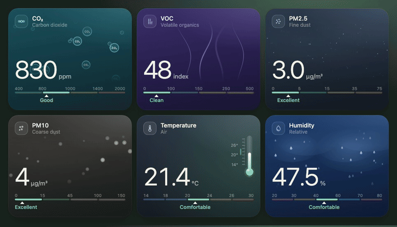
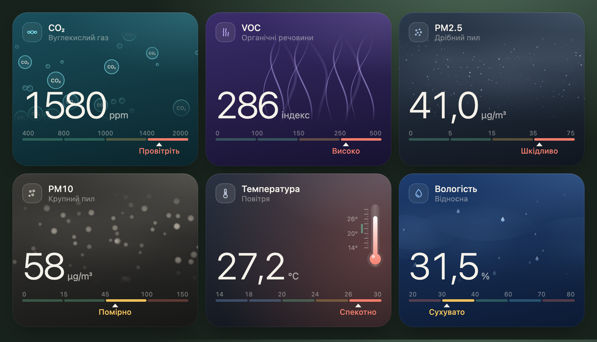
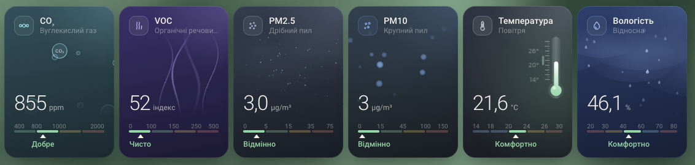
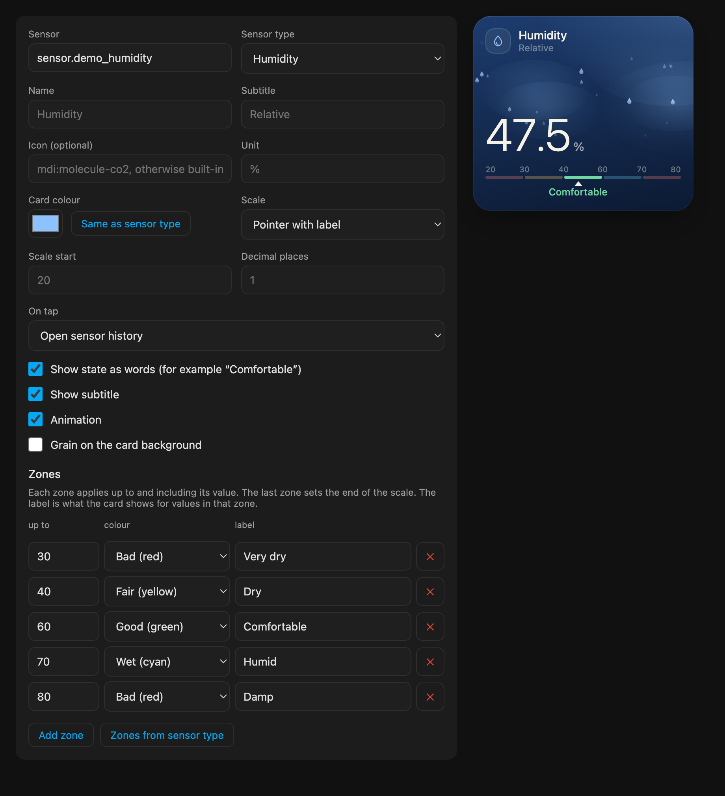

<p align="center"></p>

<h1 align="center">Breathe Cards</h1>

<p align="center">Living cards for <a href="https://www.home-assistant.io/">Home Assistant</a>: each card shows what its sensor measures.</p>

<p align="center">
  <a href="https://hacs.xyz/docs/faq/custom_repositories/"></a>
  <a href="https://github.com/breathe-cards/breathe-cards/releases/latest"></a>
  <a href="LICENSE"></a>
  <a href="https://github.com/breathe-cards/breathe-cards/actions/workflows/ci.yml"></a>
</p>

<p align="center">🇺🇦 <a href="README.uk.md">Українська версія</a></p>



Rising CO₂ bubbles, drifting dust, vapour wisps, mist and droplets, a glass thermometer. A zone scale with a word for the current state tells you at a glance whether the air is fine.

## Features

- One card per sensor: CO₂, VOC, PM2.5, PM10, temperature, humidity, or any other numeric sensor.
- A live illustration for each sensor type. It gets denser as the reading gets worse, pauses when the card is off screen and respects “reduce motion”.
- A zone scale where every zone has the same width, so short and long ranges read equally well.
- Your own zones: limits, colours and the word shown for each zone, or no words at all.
- Visual editor for every option, YAML works too.
- Tapping the card opens the standard Home Assistant history dialog.
- Fits phones, tablets and desktops; supports the sections and masonry dashboards.
- English and Ukrainian, picked from your Home Assistant language. Temperature zones switch to °F when the sensor reports °F.

When the air gets worse, the illustration gets denser and the state word changes:



On a real Home Assistant dashboard (Ukrainian interface):



## Installation

### HACS (recommended)

1. Open **HACS** in Home Assistant.
2. Open the menu (⋮) → **Custom repositories**.
3. Add `https://github.com/breathe-cards/breathe-cards`, type **Dashboard**.
4. Find **Breathe Cards**, open it and select **Download**.
5. Reload the browser page.

### Manual

1. Download `breathe-cards.js` from the [latest release](https://github.com/breathe-cards/breathe-cards/releases/latest).
2. Copy it to `/config/www/breathe-cards.js`.
3. Go to **Settings → Dashboards → ⋮ → Resources → Add resource**, URL `/local/breathe-cards.js`, type **JavaScript module**.
4. Reload the browser page.

## Usage

Add a card from the card picker (**Breathe Air Card**) or in YAML:

```yaml
type: custom:breathe-air-card
entity: sensor.living_room_co2
```

The sensor type is detected from the sensor's device class or name. If it is not detected, set `preset`:

```yaml
type: custom:breathe-air-card
entity: sensor.living_room_tvoc
preset: voc
name: Living room VOC
scale: segments
show_state: true
zones:
  - { to: 100, level: good, label: Clean }
  - { to: 250, level: fair, label: Elevated }
  - { to: 500, level: bad, label: High }
```

### Visual editor

Every option is available in the card editor, including your own zones and state words:



### Options

| Option | Default | Description |
| --- | --- | --- |
| `entity` | required | A numeric sensor. |
| `preset` | detected | `co2`, `voc`, `pm25`, `pm10`, `temperature`, `humidity`, `generic`. Sets the illustration, icon, colour, unit and default zones. |
| `name` | from preset | Card title. |
| `subtitle` | from preset | Line under the title. |
| `show_subtitle` | `true` | Show the subtitle. |
| `icon` | built-in | Any `mdi:` icon instead of the built-in one. |
| `unit` | from preset or sensor | Unit next to the value. |
| `color` | from preset | Card colour, for example `"#7ADBE6"`. The background is derived from it. |
| `scale` | `pointer` | `pointer` (caret with the state word), `segments` (current zone opens with its name), `ring` (small ring next to the value), `none`. |
| `show_state` | `true` | Show the state word (for example “Comfortable”). |
| `zones` | from preset | List of `{ to, level, label, color }`. A zone covers values up to and including `to`. `level` is `good`, `fair`, `bad`, `cold` or `wet`; `color` overrides it. The last zone ends the scale. |
| `min` | from preset | Start of the scale. |
| `decimals` | from preset | Decimal places, 0–3. |
| `animation` | `true` | Turn the illustration off. The thermometer stays, it is part of the reading. |
| `grain` | `false` | A subtle grain texture on the background. |
| `tap_action` | more-info | `{ action: none }` turns tapping off. |

On a sections dashboard a card takes 6 of 12 columns and 4 rows by default; it can be resized from 3 columns and 3 rows.

### Default zones

| Preset | Zones |
| --- | --- |
| CO₂, ppm | ≤ 800 Excellent · ≤ 1000 Good · ≤ 1400 Stuffy · ≤ 2000 Ventilate |
| VOC, index | ≤ 100 Clean · ≤ 150 Normal · ≤ 250 Elevated · ≤ 500 High |
| PM2.5, µg/m³ | ≤ 5 Excellent · ≤ 15 Good · ≤ 35 Moderate · ≤ 75 Unhealthy |
| PM10, µg/m³ | ≤ 15 Excellent · ≤ 45 Good · ≤ 100 Moderate · ≤ 150 Unhealthy |
| Temperature, °C | ≤ 18 Cold · ≤ 20 Cool · ≤ 24 Comfortable · ≤ 26 Warm · ≤ 30 Hot |
| Humidity, % | ≤ 30 Very dry · ≤ 40 Dry · ≤ 60 Comfortable · ≤ 70 Humid · ≤ 80 Damp |

PM limits follow the WHO 2021 air quality guidelines. VOC sensors report in different units (an index from 0 to 500, ppb or mg/m³). The defaults assume an index; for ppb or mg/m³ set your own `zones`.

## Languages

The card follows your Home Assistant language. Built in: **English** and **Ukrainian**. Other languages show English for now. Adding one is a single block of text in [`src/core/i18n.js`](src/core/i18n.js); pull requests with translations are welcome.

## Troubleshooting

- **“Custom element doesn't exist: breathe-air-card”.** Reload the browser page. In the mobile app, close it completely and open it again so it loads the new file.
- **The VOC card shows odd states.** VOC sensors report in different units. Set `zones` to match your sensor's unit.
- **No animation.** Check that `animation` is not `false` and that “reduce motion” is off in your operating system; the card also pauses while it is off screen.

## Compatibility

Tested with Home Assistant 2026.11 in current Chrome, and on the demo page at phone, tablet and desktop widths. Needs a browser or companion app from 2023 or later (Chrome 111, Safari 16.2, Firefox 113): the card uses CSS container queries and `color-mix()`. The card draws its own dark background, so it looks the same with light and dark themes.

## Development

```bash
npm install
npm test          # unit tests
npm run build     # writes dist/breathe-cards.js
npm run watch     # rebuild on save
```

Open `demo/index.html` through any local web server (for example `python3 -m http.server`) to see every card, variant and the editor with simulated sensors.

The code is split so new things are added as separate files: illustrations in `src/animations/`, scales in `src/scales/`, sensor types in `src/core/presets.js`, languages in `src/core/i18n.js`, and new cards in `src/cards/`. See [CONTRIBUTING.md](CONTRIBUTING.md).

## License

[MIT](LICENSE)

