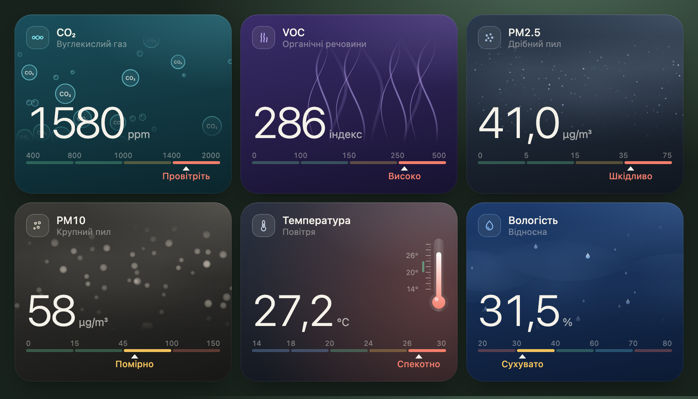
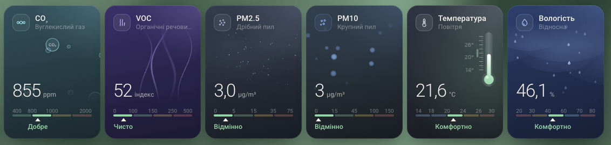

# Breathe Cards

Картки якості повітря для [Home Assistant](https://www.home-assistant.io/), які показують, що саме вимірює датчик: бульбашки CO₂, пил у повітрі, струмені випарів, туман і краплі, скляний термометр. Шкала із зонами і слово стану одразу кажуть, чи все гаразд із повітрям.

🇬🇧 [English version](README.md)



На справжньому дашборді Home Assistant:



## Можливості

- Одна картка на датчик: CO₂, VOC, PM2.5, PM10, температура, вологість або будь-який інший числовий датчик.
- Жива ілюстрація для кожного типу датчика. Густішає, коли показник гіршає, зупиняється, коли картки не видно, і зважає на налаштування «зменшити рух».
- Шкала, де всі зони однакової ширини, тож і короткі, і довгі діапазони читаються однаково.
- Свої зони: межі, кольори і слово для кожної зони, або взагалі без слів.
- Візуальний редактор для всіх налаштувань, YAML теж працює.
- Натискання відкриває стандартне вікно історії датчика.
- Підлаштовується під телефон, планшет і комп'ютер; працює на дашбордах із секціями та масонрі.
- Англійська й українська мови, за мовою Home Assistant. Зони температури переходять на °F, якщо датчик звітує у °F.

## Встановлення

### HACS (рекомендовано)

1. Відкрийте **HACS** у Home Assistant.
2. Меню (⋮) → **Custom repositories**.
3. Додайте `https://github.com/breathe-cards/breathe-cards`, тип **Dashboard**.
4. Знайдіть **Breathe Cards**, відкрийте і натисніть **Download**.
5. Оновіть сторінку браузера.

### Вручну

1. Завантажте `breathe-cards.js` з [останнього релізу](https://github.com/breathe-cards/breathe-cards/releases/latest).
2. Покладіть його в `/config/www/breathe-cards.js`.
3. **Налаштування → Дашборди → ⋮ → Ресурси → Додати ресурс**, адреса `/local/breathe-cards.js`, тип **JavaScript-модуль**.
4. Оновіть сторінку браузера.

## Використання

Додайте картку з каталогу карток (**Breathe Air Card**) або в YAML:

```yaml
type: custom:breathe-air-card
entity: sensor.living_room_co2
```

Тип датчика визначається з класу пристрою або назви. Якщо не визначився, задайте `preset`:

```yaml
type: custom:breathe-air-card
entity: sensor.living_room_tvoc
preset: voc
name: VOC у вітальні
scale: segments
zones:
  - { to: 100, level: good, label: Чисто }
  - { to: 250, level: fair, label: Підвищено }
  - { to: 500, level: bad, label: Високо }
```

Повний список налаштувань і стандартні зони — в [англійському README](README.md#options).

## Ліцензія

[MIT](LICENSE)
